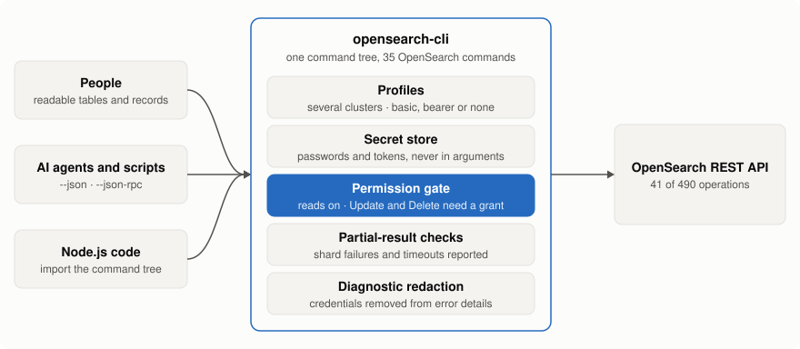
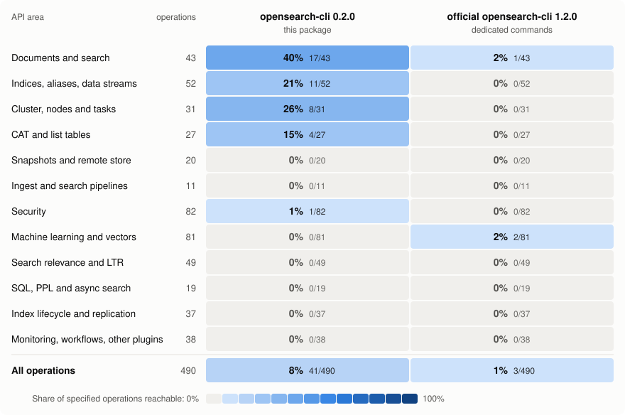

# opensearch-cli

**Search, inspect and change OpenSearch clusters through typed commands that are safe to hand to an AI agent.**

```sh
npm install --global @eyeauras/opensearch-cli
opensearch-cli profile configure --url https://cluster.example.com:9200 --auth basic --username operator --password-stdin
opensearch-cli indices list        # the password above is read from stdin, never from an argument
```

## Why

| | |
|---|---|
| **Read-only by default** | A fresh profile can only read. Writes need `permissions grant Update` and deletions a separate `permissions grant Delete`, per profile. `indices delete` also refuses wildcards and `_all` without `--allow-wildcards`. |
| **Typed, not raw** | 35 commands cover 41 API operations with checked flags and shaped results: search, documents, bulk, reindex, indices, aliases, fields, nodes, shards, tasks. There is no free-form request command that could slip past the permission gate. |
| **Honest about partial results** | Search and count report failed shards as a `partial` block in JSON and a warning on stderr; search adds timeouts and lower-bound totals. `--fail-on-partial` turns them into a failure with code `search.partial`. |
| **Bounded** | `search` returns one page of 10 hits. `--all` pages through a point in time, requires an explicit `--max-results` budget and cleans up the point in time when it finishes, fails or is cancelled. |
| **Cheap for agents** | `--json` on every command, `search --fields` to fetch only the source fields the question needs, stable error codes such as `index.notFound` and `document.conflict`, and a persistent `--json-rpc` session without restarting Node. |
| **No leaked secrets** | Passwords and tokens are read from stdin and kept in the platform secret store, never in profile files or command arguments. Credentials are redacted from error diagnostics. |

<picture>
  <source media="(prefers-color-scheme: dark)" srcset="docs/images/how-it-works-dark.svg">
  
</picture>

## Coverage

Share of the 490 operations in the official OpenSearch API specification each tool can call
through its own commands, by API area.

<picture>
  <source media="(prefers-color-scheme: dark)" srcset="docs/images/coverage-matrix-dark.svg">
  
</picture>

The other columns are the three most-starred command-line tools for OpenSearch that were found:
curator-opensearch (index and snapshot housekeeping), elasticdump (import and export) and the
OpenSearch project's own `opensearch-cli`.
The official CLI also has a raw `curl` command that can send almost any request (481 of the 490
operations); this CLI deliberately has none, so every call stays typed and permission-gated.
Numbers, method, caveats and every tool considered: [coverage comparison](docs/coverage-comparison.md).

## Use it

```sh
# read: pick the fields, get JSON
opensearch-cli search 'sample-*' --q "category:example" --fields title,category --size 20 --json

# write: allow it for the profile once, then index a document
opensearch-cli permissions grant Update
opensearch-cli docs index sample-a doc-1 --body-file document.json

# discover: every level has help
opensearch-cli --help
opensearch-cli indices --help
```

Needs Node.js 22+. Targets OpenSearch 2.x and 3.x; `search --all` needs 2.4 or newer. Your
account's permissions on the cluster still decide what a call is allowed to do.

## More

- [Command reference](docs/reference.md): every command family, paging, partial results, writes, bulk, diagnostics.
- [Coverage comparison](docs/coverage-comparison.md) and the [API inventory](tools/api-inventory/README.md) it is measured against.
- [Testing and fixtures](docs/testing.md), [release guide](docs/release.md) and the [roadmap](https://github.com/iXab3r/opensearch-cli/issues/7).
- Built on CliFactory (`@eyeauras/cli-factory`). [MIT licensed](LICENSE).
